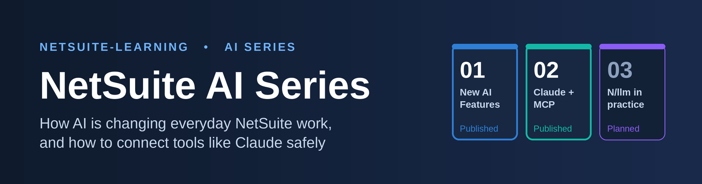
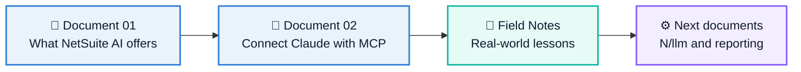

<div align="center">




### How AI is changing everyday NetSuite work, and how to connect tools like Claude safely

**Short, clean documents. Real setup steps. Honest notes on what is live and what is only announced.**

[⚡ In one minute](#-in-one-minute) &nbsp;•&nbsp; [📚 All documents](#-all-documents) &nbsp;•&nbsp; [🧭 Where to start](#-where-to-start) &nbsp;•&nbsp; [🗺️ Roadmap](#%EF%B8%8F-series-roadmap) &nbsp;•&nbsp; [⬅️ Main repo](../README.md)

</div>

---

## ⚡ In one minute

> [!TIP]
> This series is my learning path through **AI in NetSuite**. It starts with what NetSuite has shipped, then shows how to connect an outside AI assistant such as **Claude** to NetSuite using **MCP (Model Context Protocol)**, with every request limited by a NetSuite role. Each document is short, easy to follow, and written so you can try it in a Sandbox account.

| 🎯 You want to | 📖 Read |
|---|---|
| See what NetSuite AI offers and when it arrived | [Document 01: New AI Features](./Document-01-New-AI-Features/) |
| Connect Claude to NetSuite, step by step | [Document 02: Claude AI Integration](./Document-02-Claude-AI-Integration/) |
| Judge what is safe to enable | The security and checklist sections of both documents |

---

## 📚 All documents

| # | Document | What you get | Status |
|---|---|---|---|
| 01 | **[New AI Features in NetSuite](./Document-01-New-AI-Features/)** | Release timeline from 2023 to SuiteWorld 2026, feature guide, adoption checklist | ✅ Published |
| 02 | **[Claude AI Integration with NetSuite](./Document-02-Claude-AI-Integration/)** | MCP explained, 6-step setup, role permissions, test prompts, common fixes | ✅ Published |
| FN 01 | Field Note: Connecting Claude AI to NetSuite | Lessons from real use | 🚧 In progress |
| 03 | SuiteScript Generative AI (N/llm) in practice | Using AI inside scripts | 📝 Planned |
| 04 | ODBC and SuiteAnalytics reporting | Reporting outside NetSuite | 📝 Planned |

---

## 🧭 Where to start



| 👤 If you are | 🚀 Start with |
|---|---|
| New to NetSuite AI | Document 01, then Document 02 |
| A NetSuite admin who wants to try Claude | Document 02, in a Sandbox account |
| A developer or consultant | Document 02 for setup, then the field notes |
| Evaluating AI for your business | Document 01 timeline and checklist, plus the notes on roles and review |

---

## 📖 What each document covers

<details>
<summary><b>📘 Document 01: New AI Features in NetSuite</b></summary>

- How NetSuite AI grew from Text Enhance (2023) to SuiteWorld 2026
- Six categories of AI in NetSuite
- A before and now guide for writing, finance and close, reports, sales and service
- Developer and integration capabilities, including the AI Connector Service
- A quick adoption checklist

</details>

<details>
<summary><b>🔌 Document 02: Claude AI Integration with NetSuite</b></summary>

- How MCP connects Claude (client) to NetSuite (server)
- What you need before you start
- Six setup steps: enable features, install MCP Standard Tools, create the MCP role, assign it, add the connector in Claude, test
- The four role permissions and the MCP URL format
- Read-only test prompts and the five most common fixes

</details>

---

## 🗺️ Series roadmap

<details>
<summary><b>What is planned next</b></summary>

- 🚧 **Field Note 01:** connecting Claude to NetSuite, with lessons from real use
- 📝 **Document 03:** SuiteScript Generative AI (N/llm) in practice
- 📝 **Document 04:** ODBC and SuiteAnalytics reporting

Plans can change as NetSuite releases new features.

</details>

---

## 🧰 How this series is written

- **Short and clear.** Each document aims to be readable in a few minutes.
- **Announced is not the same as live.** I note when a feature depends on your release, region or licensing, and suggest confirming it in Oracle's release notes.
- **Sandbox first.** Every setup step is meant to be tried in a Sandbox account before Production.
- **Sanitized.** No client data, credentials or confidential logic appear anywhere in this series.

> [!WARNING]
> NetSuite and its AI features change often. Menu names, permission tabs and tool names can differ by release, so check Oracle's current documentation before relying on any step in production.

---

## 📂 Folder structure

```text
AI-Series/
├── assets/                                  # series banner
├── Document-01-New-AI-Features/             # README, PDF, Word, assets
├── Document-02-Claude-AI-Integration/       # README, PDF, Word, assets
├── Field-Notes/                             # real-world notes
└── README.md                                # you are here
```

Each document folder has its own README, plus a downloadable **PDF** and **Word** file.

---

## 🤝 Connect

<div align="center">

**Built in public as part of my NetSuite learning journey** 🚀

[⬅️ Back to the main repository](../README.md)

[](https://github.com/ManojMohite2002/NetSuite-Learning)
[](https://www.linkedin.com/in/manojmohite2002/)

*Feedback, corrections and topic requests are always welcome.*

</div>
