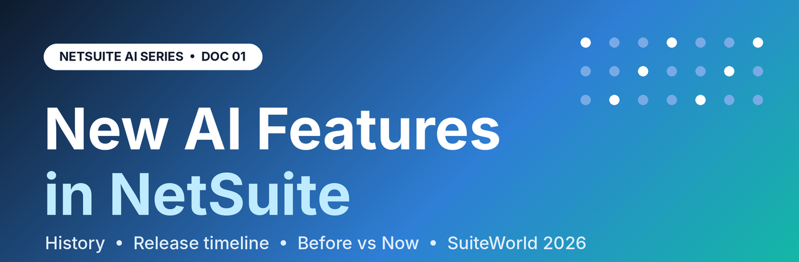
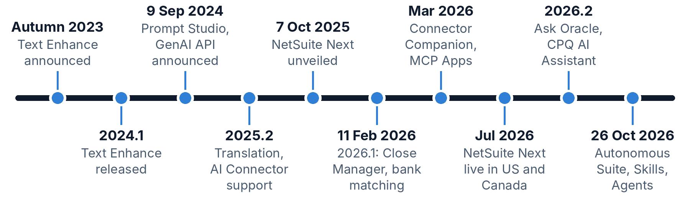
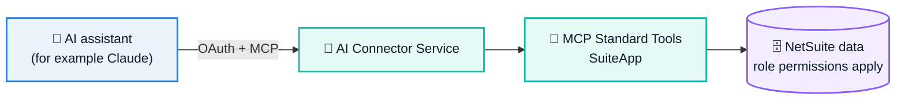

### From Text Enhance to the Autonomous Suite: how NetSuite AI grew, and what it changes for everyday work

[📄 Read the PDF](NetSuite_New_AI_Features_Document01.pdf) &nbsp;•&nbsp; [📝 Download the Word file](NetSuite_New_AI_Features_Document01.docx)

---

## ⚡ In one minute

> [!TIP]
> NetSuite AI started as quiet background machine learning, became generative AI with **Text Enhance** (announced 2023, released in 2024.1), and by **SuiteWorld 2026** had grown into **Ask Oracle, SuiteSkills and SuiteAgents** inside NetSuite Next. Outside AI tools such as Claude can also connect through the **AI Connector Service (MCP)**.

| 🕰️ Before | ✨ Now |
|---|---|
| Type every email, description and note by hand | Generate, rewrite and translate text in place |
| Build a saved search to answer one question | Ask in plain language, save the question as a skill |
| Match bank lines manually | Review AI-suggested matches with confidence scores |
| Custom integration for every AI tool | One standards-based connection (MCP) |

---

## 🗺️ Release timeline

<b>📅 Click for the full dated table</b>

| Date | Milestone |
|---|---|
| Autumn 2023 | Text Enhance announced |
| 2024.1 (early 2024) | Text Enhance released (North America first) |
| 9 Sep 2024 | Prompt Studio, SuiteScript Generative AI API and SuiteAnalytics Assistant announced |
| 2025.2 (H2 2025) | Text Enhance translation; custom tool scripts for the AI Connector Service |
| 7 Oct 2025 | NetSuite Next unveiled; new SuiteCloud AI platform announced |
| 11 Feb 2026 | 2026.1 AI features announced: Intelligent Close Manager, AI bank matching |
| Late Mar 2026 | AI Connector Service Companion and MCP Apps announced |
| Jul 2026 | NetSuite Next live in the US and Canada |
| Aug to Oct 2026 | 2026.2: Ask Oracle, AI Canvas, CPQ AI Assistant |
| 26 Oct 2026 | SuiteWorld 2026: Autonomous Suite, 45+ SuiteSkills, industry SuiteAgents |

---

## 🧩 How outside AI connects to NetSuite

---

## 📚 What is inside

| | Section | You will learn |
|---|---|---|
| 1️⃣ | **Journey at a glance** | Dated timeline from 2023 to SuiteWorld 2026 |
| 2️⃣ | **Six AI categories** | Conversational, generative, purchased, developer, machine learning, analytics |
| 3️⃣ | **Feature guide** | Text Enhance, Prompt Studio, Ask Oracle, NetSuite Next, finance and close, reports, sales and service |
| 4️⃣ | **Developer and integration** | N/llm, AI Connector Service, MCP Standard Tools, custom tool scripts |
| 5️⃣ | **Cost and availability** | Included vs purchased, AI Units, regions, rollout |
| 6️⃣ | **SuiteWorld 2026** | SuiteSkills, AI Portlets, SuiteAgents, Data Intelligence rename |
| 7️⃣ | **Security and governance** | Roles, permissions, human review |
| 8️⃣ | **Adoption checklist** | Pilot steps you can follow |

<b>🔥 SuiteWorld 2026 highlights</b>

- **SuiteSkills (45+):** packaged NetSuite expertise for AI, usable in Ask Oracle and in outside AI tools
- **AI Portlets and AI Workspaces:** describe the dashboard you want
- **Industry SuiteAgents:** software, product, services, healthcare, construction, nonprofit
- **NetSuite Data Intelligence:** new name for NetSuite Analytics Warehouse
- **SuiteAgent Studio:** shown in the keynote, listed for a future release

---

## ✅ Quick adoption checklist

- [ ] Confirm your release and whether NetSuite Next or Ask Oracle is available
- [ ] Review the AI Preferences page
- [ ] Review roles and permissions before enabling conversational features
- [ ] Run a small pilot and track AI Units
- [ ] Add a human review step for anything that affects financial data

> [!WARNING]
> **Announced is not the same as live in your account.** Check your release, region and licensing. The exact releases for Prompt Studio, N/llm and the AI Connector Service are reported differently across sources, so confirm them in Oracle's release notes. Statements about AI pricing made on stage at SuiteWorld 2026 were not in Oracle's press releases.

---

## 🧭 Series navigation

| ⬅️ Previous | 📍 Current | ➡️ Next |
|---|---|---|
| [Week 28: Advanced Saved Search & Performance](../) | **Document 01: New AI Features in NetSuite** | Field Note #01: Connecting Claude AI to NetSuite |

---

**Built in public as part of my NetSuite learning journey** 🚀

*Lessons only. No confidential or client details.*

