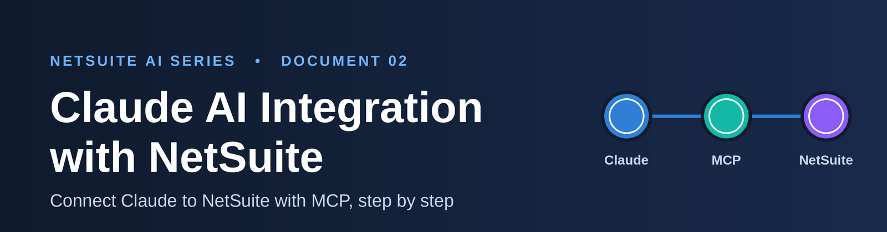
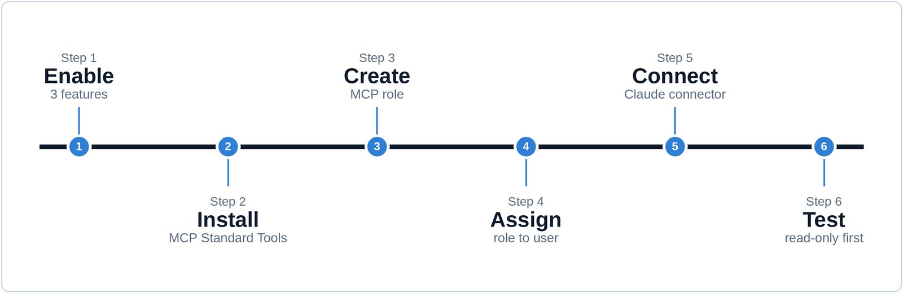
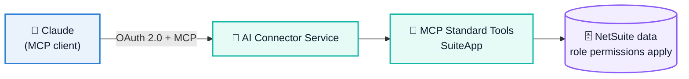

<div align="center">




### Connect Claude to NetSuite using MCP: a simple 6-step setup guide

[📄 Read the PDF](ClaudeMCPIntegration_NetSuite_Week30.pdf) &nbsp;•&nbsp; [📝 Download the Word file](ClaudeMCPIntegration_NetSuite_Week30.docx)

</div>

---

## ⚡ In one minute

> [!TIP]
> **MCP (Model Context Protocol)** lets Claude connect to NetSuite through the **AI Connector Service**. NetSuite hosts the MCP server, Claude is the MCP client, and every request runs with the **role** you choose at sign-in. You can ask for records, reports and SuiteQL results in plain language.

| 🕰️ Without MCP | ✨ With MCP |
|---|---|
| Build a saved search or report for every question | Ask in plain language and get the answer |
| Export data, then paste it into an AI tool | Claude reads NetSuite directly, within your role |
| A custom integration for each AI tool | One standards-based connection |
| Anyone with a broad role can see everything | Access limited to a dedicated MCP role |

---

## 🗺️ Setup at a glance



<details>
<summary><b>🛠️ Click for the detailed steps</b></summary>

| Step | Where | What to do |
|---|---|---|
| 1. Enable features | Setup > Company > Enable Features > SuiteCloud | Tick **Server SuiteScript**, **OAuth 2.0**, **REST Web Services** and Save |
| 2. Install the SuiteApp | Customization > SuiteCloud Development > SuiteApp Marketplace | Search **MCP Standard Tools**, click Install, confirm under Installed SuiteApps |
| 3. Create the MCP role | Setup > Users/Roles > Manage Roles > New | Do not copy Administrator. Add the four permissions below and start with **View only** on records |
| 4. Assign the role | Setup > Users/Roles > Manage Users | Add the MCP role on the Access subtab |
| 5. Connect Claude | Claude: Settings > Connectors > Add custom connector | Name it, paste the MCP URL, click Connect, sign in, choose the **MCP role**, click Allow |
| 6. Test | New chat in Claude | Ask which account and role you are connected to, then run read-only prompts |

**MCP URL format** (account ID in lowercase, underscore written as a hyphen, so `1234567_SB1` becomes `1234567-sb1`):

```text
https://<account-host>/services/mcp/v1/suiteapp/com.netsuite.mcpstandardtools
https://<account-host>/services/mcp/v1/all
```

</details>

<details>
<summary><b>🔐 The four role permissions</b></summary>

| Permission | Tab | Level | Why |
|---|---|---|---|
| MCP Server Connection | Setup | Full | Lets the role use the connector |
| Log in using OAuth 2.0 Access Tokens | Setup | Full | Lets Claude sign in |
| REST Web Services | Setup | Full | Needed by the record tools |
| Perform Search | Lists | Full | Needed by search and saved search tools |

</details>

---

## 🧩 How the connection works



---

## 📚 What is inside

| | Section | You will learn |
|---|---|---|
| 1️⃣ | **How the connection works** | Claude as MCP client, NetSuite as MCP server |
| 2️⃣ | **Before you start** | Admin access, Claude plan, Sandbox, account ID |
| 3️⃣ | **Setup in 6 steps** | Features, SuiteApp, role, user, connector, test |
| 4️⃣ | **Common problems and fixes** | The five most frequent issues |
| 5️⃣ | **Key takeaways** | Sandbox first, dedicated role, View only |

<details>
<summary><b>🧪 Try these read-only prompts first</b></summary>

- Which NetSuite account and role am I connected to?
- Show my top 10 customers by revenue this year.
- List open sales orders from the last 30 days.

</details>

<details>
<summary><b>🧯 Quick fixes</b></summary>

- **Connector shows disconnected:** check the URL is lowercase with hyphens, or try the `/all` URL.
- **Tool list is empty:** check MCP Standard Tools is installed, the role has all four permissions, and you did not sign in as Administrator.
- **"Invalid login attempt":** click Choose Another Role and pick the MCP role.
- **Some tools missing:** add the record permission. Edits need Edit or Full, not View.

</details>

---

## ✅ Quick setup checklist

- [ ] Set up and test in **Sandbox** first
- [ ] Enable Server SuiteScript, OAuth 2.0 and REST Web Services
- [ ] Install **MCP Standard Tools**
- [ ] Create a dedicated MCP role with the four permissions (not Administrator)
- [ ] Start with **View only** record permissions
- [ ] Connect from Claude and choose the MCP role at sign-in
- [ ] Run read-only prompts before testing any write

> [!WARNING]
> **MCP Standard Tools is managed by Oracle and updates automatically**, so tool names and counts can change over time. Menu names and permission tabs can also differ by release. Guides report the Claude free plan does not support connectors, so confirm for your plan.

---

## 🧭 Series navigation

| ⬅️ Previous | 📍 Current | ➡️ Next |
|---|---|---|
| [Document 01: New AI Features in NetSuite](../) | **Document 02: Claude AI Integration with NetSuite** | Coming soon |

---

<div align="center">

**Built in public as part of my NetSuite learning journey** 🚀

[](https://github.com/ManojMohite2002/NetSuite-Learning)
[](https://www.linkedin.com/in/manojmohite2002/)

</div>
