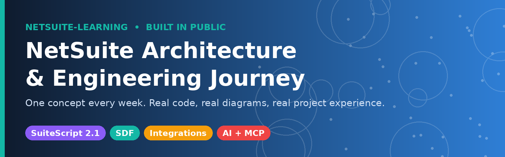
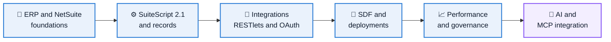

<div align="center">




### NetSuite Architecture & Engineering Journey

**One concept every week. Real code, real diagrams, real project experience.**

[🧭 Start here](#-start-here) &nbsp;•&nbsp; [🤖 AI Series](#-new-netsuite-ai-series) &nbsp;•&nbsp; [🗺️ Roadmap](#%EF%B8%8F-learning-roadmap) &nbsp;•&nbsp; [📂 Structure](#-repository-structure) &nbsp;•&nbsp; [🤝 Connect](#-connect)

</div>

---

## ⚡ In one minute

> [!TIP]
> This repo is my public NetSuite notebook. Every Sunday I document what I built or learned, push it here, and share it on LinkedIn. It started as architecture and engineering notes (SDF, RESTlets, Suitelets, governance, performance) and now also covers **NetSuite AI** and **connecting AI tools such as Claude to NetSuite**.

| 👤 If you are | 🎯 Start with |
|---|---|
| New to SuiteScript | Weekly notes, in order |
| A developer working on integrations | RESTlet and Suitelet patterns, governance and concurrency |
| A consultant or functional lead | AI Series and the tax and finance documents |
| Evaluating AI for NetSuite | AI Series, Document 01 |

---

## 🧭 Start here

| 📌 Track | 📖 What you get | 🔗 Go |
|---|---|---|
| **🏗️ Weekly Architecture Journey** | One architecture or engineering concept per week, with code and diagrams | [Browse weekly folders](./) |
| **🤖 NetSuite AI Series** | How NetSuite AI grew, how outside AI connects, field notes | [Document 01](./) |
| **🧾 Tax and Finance Series** | Tax architecture, GST, HSN and SAC in NetSuite | [Browse](./) |
| **🛠️ Setup Guides** | SDF setup, tooling, common errors | [Browse](./) |

---

## 🆕 New: NetSuite AI Series

A separate track on how AI is changing everyday NetSuite work, written as learning notes plus field notes from real use.

| # | Document | Status |
|---|---|---|
| 01 | From Text Enhance to the Autonomous Suite: how NetSuite AI grew | ✅ Published |
| FN 01 | Field Note: Connecting Claude AI to NetSuite | 🚧 In progress |
| 02 | AI Connector Service (MCP) deep dive | 📝 Planned |
| 03 | SuiteScript Generative AI (N/llm) in practice | 📝 Planned |
| 04 | ODBC and SuiteAnalytics reporting | 📝 Planned |

---

## 🗺️ Learning roadmap



<details>
<summary><b>📅 Weekly index (click to expand)</b></summary>

| Week | Topic | Folder |
|---|---|---|
| 21 | Tax architecture | [open](./) |
| 22 | GST, HSN and SAC | [open](./) |
| 28 | Advanced Saved Search and Performance | [open](./) |

</details>

---

## 🎯 Focus areas

<details>
<summary><b>🏗️ Architecture and engineering</b></summary>

- SDF (SuiteCloud Development Framework)
- RESTlet + Suitelet architecture patterns
- Multi-environment deployment strategies
- Concurrency and governance handling
- Performance optimization techniques

</details>

<details>
<summary><b>🔌 Integrations</b></summary>

- OAuth 2.0 and token-based authentication patterns
- Scheduled and Map/Reduce sync designs
- Third-party system integration patterns (HR, collaboration tools)

</details>

<details>
<summary><b>🤖 AI and automation</b></summary>

- NetSuite AI features and release timeline
- AI Connector Service and MCP
- Using Claude with NetSuite safely (roles, permissions, human review)

</details>

---

## 📂 Repository structure

```text
NetSuite-Learning/
├── assets/                     # banners, timelines, diagrams
├── Week-XX-Topic-Name/         # one folder per weekly topic
│   ├── README.md               # summary, key takeaways, navigation
│   ├── notes/                  # detailed technical notes
│   ├── diagrams/               # architecture diagrams
│   ├── code/                   # SuiteScript 2.1 snippets and examples
│   └── Topic_WeekXX.docx|pdf   # downloadable document
├── AI-Series/
│   ├── Document-01-New-AI-Features/
│   └── Field-Notes/
└── README.md
```

Each topic folder includes:

- 📖 Detailed technical notes
- 🏗️ Architecture diagrams
- 🧩 Code snippets and implementation examples
- 📄 A downloadable PDF and Word version

---

## 🧰 Conventions used in the code

- SuiteScript **2.1**, modular, with clear separation of concerns
- Governance and error handling shown, not skipped
- Sanitized examples only: **no client data, credentials or confidential logic**

> [!WARNING]
> Examples are simplified for learning. Test in a sandbox before using any pattern in production.

---

## ❓ How to use this repo

1. ⭐ **Star or watch** the repo to follow new weekly drops
2. 📖 Open a weekly folder and read its README first
3. 🧪 Copy the code into a sandbox account and experiment
4. 💬 Open an **Issue** with a question, correction or topic request

---

## 🤝 Connect

<div align="center">

**Built in public. Learning every week.** 🚀

[](https://github.com/ManojMohite2002/NetSuite-Learning)
[](https://www.linkedin.com/in/manojmohite2002/)

*Feedback, corrections and topic requests are always welcome.*

</div>
